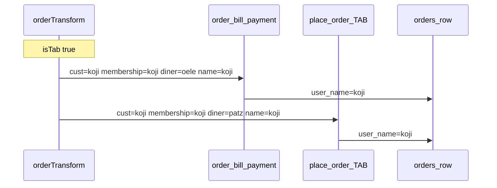

# Handoff — Credit / TAB customer payload + Credit Management diner UX (2026-11-24)

**Status:** Implemented in `pos-react/frontend`.  
**Scope:** Credit (TAB) leg only for payload; Credit Management diner filter UX.

---

## 1. TAB / Credit payload — tab holder is `cust_*`

**Yes — credit leg only.** Unpaid place-order and non-TAB payments are unchanged.

On Credit/TAB settle or prepaid TAB, the **tab holder** is the order / CRM customer (`cust_name`, `cust_mobile`, `cust_membership_id`). The person who ate stays in `diner_name` / `diner_mobile`. Ledger fields `name` / `mobile` / `crm_customer_id` remain the holder for `recordTabPayment`.

### Why

Backend writes `orders.user_name` / `user_id` from `cust_*`. Daily Report CUSTOMER and CRM sync follow that. Sending the diner in `cust_*` while the holder was only in `name`/`mobile` left CUSTOMER = diner (oele/patz) instead of holder (koji).

### Files

| Path | Change |
|------|--------|
| [`src/api/transforms/orderTransform.js`](../../frontend/src/api/transforms/orderTransform.js) | `placeOrderWithPayment` + `collectBillExisting`: when `isTab`, prefer `tabContact` for `cust_*` |
| [`src/api/transforms/__tests__/orderTransform.cr527.test.js`](../../frontend/src/api/transforms/__tests__/orderTransform.cr527.test.js) | Asserts holder in `cust_*`, diner in `diner_*` |

### Flows



### Target payloads

**Postpaid — place unpaid (unchanged)**  
`place-order` with outer customer only → `cust_*=oele` (no TAB yet).

**Postpaid — Collect Bill Credit**  
`POST /api/v2/vendoremployee/order/order-bill-payment`

| Field | Value |
|-------|--------|
| `payment_mode` | `TAB` |
| `cust_name` / `cust_mobile` | tab holder (koji) |
| `cust_membership_id` | holder CRM id (`tabContact.crmId`) |
| `name` / `mobile` / `crm_customer_id` | tab holder (ledger) |
| `diner_name` / `diner_mobile` | who ate (oele) |

**Prepaid — place + Credit**  
`POST /api/v2/vendoremployee/order/place-order` with `payment_method=TAB`

| Field | Value |
|-------|--------|
| `cust_name` / `cust_mobile` / `cust_membership_id` | tab holder (koji) |
| `name` / `mobile` / `crm_customer_id` | tab holder |
| `diner_name` / `diner_mobile` | outer diner (patz) if entered |

**Credit-only (no outer customer)**  
`cust_*` already fell through to `tabContact` — still holder.

### Code rule (`isTab`)

```js
cust_name:          isTab ? (tabContact?.name || customer?.name || '') : (customer?.name || ''),
cust_mobile:        isTab ? (tabContact?.phone || customer?.phone || '') : (customer?.phone || ''),
cust_membership_id: isTab ? (tabContact?.crmId || customer?.id || '') : (customer?.id || ''),
```

`isTab` = method `credit` or `tab`/`TAB`.

### Not changed

- Backend `OrderController` (no promote-from-`name` in this pass)
- Cash / Card / UPI / PayLater `cust_*`
- Unpaid `place-order` before Collect Bill

### Quick verify

1. oele → Collect Bill → Credit koji → request `cust_*=koji`, `diner_*=oele` → Daily Report CUSTOMER = koji.  
2. Outer patz + prepaid TAB koji → `cust_*=koji`, `diner_*=patz`.  
3. Credit fields only → `cust_*=holder`.

---

## 2. Credit Management — diner dropdown UX

**File:** [`src/components/credit/CreditCustomerDetailSheet.jsx`](../../frontend/src/components/credit/CreditCustomerDetailSheet.jsx)

### Problems

1. Diner search list (6+ diners) only scrolled via scrollbar — wheel/touch eaten by Sheet + portaled Popover.  
2. Same diner name (e.g. two “macha boi”) — no mobile at a glance; had to open bill.

### Fixes

| Item | Implementation |
|------|----------------|
| Scroll | Diner `Popover modal={false}`; `onWheel` / `onTouchMove` `stopPropagation` on `PopoverContent` + `CommandList` |
| Mobile | `dinerMap` keeps `mobile` from `dinerMobile`; dropdown two-line name + phone; chips / trigger / active summary show `name · mobile` when present |

`diner_mobile` was already on credit rows; aggregation key was already `name|mobile` — only display was missing.

### Not changed

- Credit API / `creditTransform`  
- Open-bills table columns  
- Holder phone in this filter (diner lens only)

### Quick verify

1. Holder with 6+ diners → Search diner → wheel/touch scrolls list.  
2. Two same names, different mobiles → distinct phones on rows/chips.  
3. No mobile → name only.

---

## Related earlier handoff (unrelated)

FCM / ringer pack: [`SESSION_HANDOVER_2026-11-24_FCM_RELOAD_TWO_FE_FIXES.md`](SESSION_HANDOVER_2026-11-24_FCM_RELOAD_TWO_FE_FIXES.md) — separate; do not mix into credit investigation.
