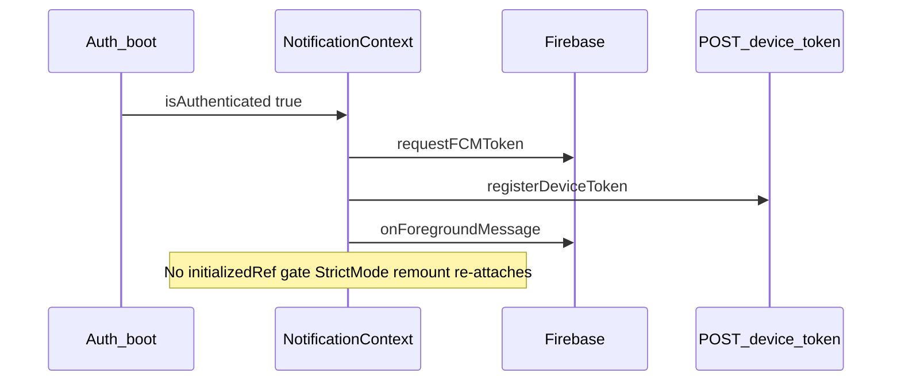
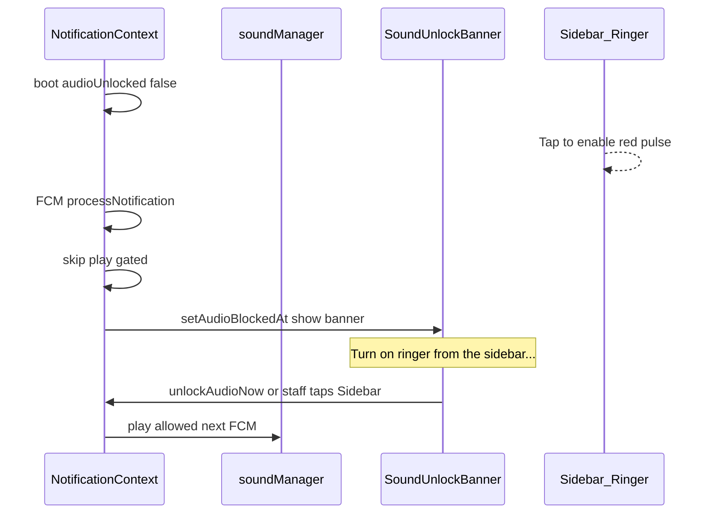
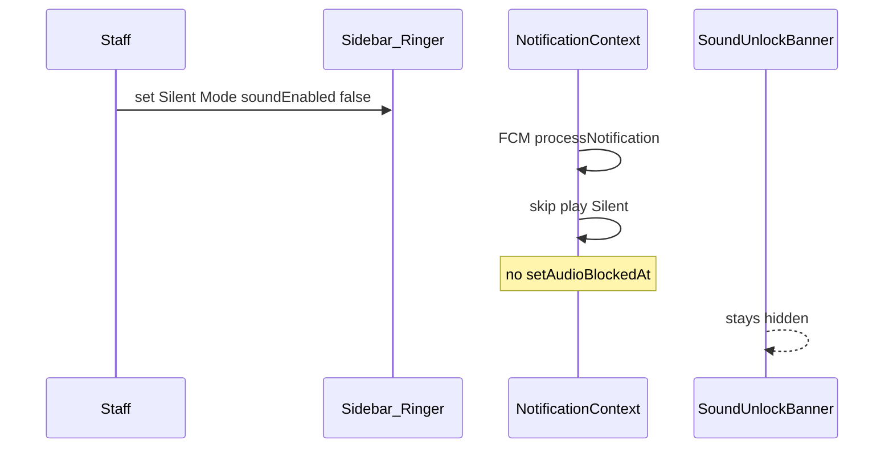
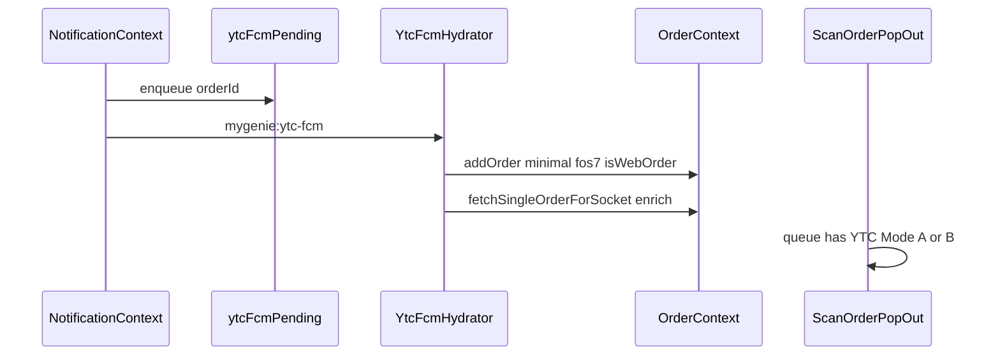

# Handoff — Implemented FE pack (2026-11-24)

**Status:** Implemented locally in `pos-react/frontend` (investigation/handoff for next agent).

**Out of scope (do not invent):** backend data-only FCM, `forceRefresh`/`deleteToken`, cross-device mute, auto-unlock on random click.

---

## What was implemented (checklist)

1. FCM foreground listener survives hard reload (StrictMode-safe).
2. Boot device-token register: `getToken` → `POST /device-token` → then `onForegroundMessage`.
3. Sidebar Ringer states: **Ringer On** / **Silent Mode** / **Tap to enable** (pulse red).
4. Play gated until `audioUnlocked` (no ring while Tap to enable).
5. Floating red `SoundUnlockBanner` only when **Tap-to-enable / autoplay locked** — **not** when staff intentionally chose Silent Mode.
6. Instance-only Mute: `stop()` only; no orderId suppress of later FCM.
7. YTC popup after reload: FCM enqueue → optimistic order → fetch enrich (works during `/loading`).
8. Edit → Update Order on web Not-Confirm: BE `updateOrderCommon` additively promotes `food_status=7` + KOT via existing socket (FE no longer calls `confirmOrder`).
9. Accept / Reject / item-cancel / Mute: `soundManager.stop()` so long buzzers cut off.

---

## Sidebar Ringer — before vs after this pack

| | Before | After |
|--|--------|--------|
| States | Ringer On / Silent Mode only | + **Tap to enable** (red pulse) |
| Click | Always toggled `soundEnabled` | If Tap-to-enable → `unlockAudioNow()`; else toggle Silent ↔ On |
| Banner | N/A (or later showed for Silent too) | Banner **only** for locked autoplay |

**Intentional vs not (detection already in flags):**

| Flag | Meaning | Intentional? | Banner? |
|------|---------|--------------|---------|
| `!soundEnabled` | Staff set Silent Mode in sidebar | Yes | **No** |
| `!audioUnlocked` | Browser autoplay not unlocked (e.g. hard reload) | No | **Yes** (on order / boot lock) |

Silent suppress path logs `Sound suppressed — Silent Mode` + diag `suppressed_sound_off` but does **not** call `setAudioBlockedAt`.

---

## End-to-end flows

### A. Hard reload → FCM listen

**File:** `contexts/NotificationContext.jsx` (auth `useEffect`)  
**Log:** `[Notification] Foreground FCM listener attached`

### B. Reload → Tap to enable → order (banner OK)

**Suppress log:** `Sound suppressed — Tap to enable ringer first` / diag `suppressed_needs_unlock`

### B2. Intentional Silent Mode → order (no banner)

**Suppress log:** `Sound suppressed — Silent Mode` / diag `suppressed_sound_off`  
**Banner click:** `unlockAudioNow()` only — does not force Silent off (sidebar stays staff control).

### C. YTC popup after reload (FCM before/without socket)

**Files:** `utils/ytcFcmPending.js`, `components/notifications/YtcFcmHydrator.jsx` (in `AppProviders.jsx` under `OrderProvider`), `LoadingPage.jsx` (preserves pending YTC on `setOrders`)

### D. Mute / Accept / cancel vs long buzzer

- **Mute:** `stop()` + visual snooze only (no `toggleOrderMute` / no future FCM suppress). Device-local.
- **Accept / Reject / item cancel / reject-new:** `stopBuzzer()` → `soundManager.stop()` in `ScanOrderPopOut.jsx`.

### E. Web-edit banner stuck (food_status 7)

Edit from popup → OrderEntry Update Order used to leave `food_status=7` → popup stuck.  

**Fix (additive BE):** `OrderController::updateOrderCommon` — if any `OrderDetail` still has `food_status=7` after cart update, promote to `def_ord_status`, merge those IDs into `newlyAddedItems`, set `print_kot=Yes`, then the existing single `publishOrderToSocket(update-order, Y, …)` prints KOT. No pending 7 → unchanged. Accept (`waiter_dinein_order_status_update`) untouched.  

FE no longer calls `confirmOrder` after Update Order.  

**Files:** `app/Http/Controllers/Api/V2/Vendoremployee/OrderController.php`, `components/order-entry/OrderEntry.jsx`

---

## Key files

| Path | Role |
|------|------|
| `src/contexts/NotificationContext.jsx` | FCM attach, play gate, Silent vs unlock suppress, YTC event, banner mount, boot lock |
| `src/contexts/AppProviders.jsx` | `YtcFcmHydrator` under OrderProvider |
| `src/components/layout/Sidebar.jsx` | Ringer On / Silent / Tap to enable |
| `src/components/notifications/SoundUnlockBanner.jsx` | Unlock-only banner (`!audioUnlocked`); not for intentional Silent |
| `src/components/notifications/YtcFcmHydrator.jsx` | Optimistic + fetch YTC |
| `src/utils/ytcFcmPending.js` | Pending FCM order ids |
| `src/pages/LoadingPage.jsx` | Merge/preserve YTC on boot setOrders |
| `src/pages/DashboardPage.jsx` | Instance-only snooze (`stop` only) |
| `src/utils/soundManager.js` | Play/stop/unlock; mute Set helpers unused by notif path |
| `src/components/dashboard/ScanOrderPopOut.jsx` | stopBuzzer on actions; Mode A/B queue |
| `src/components/order-entry/OrderEntry.jsx` | confirm after web Update Order |

---

## Known open / next investigation

1. Confirm FCM detection uses confirm title/body OR confirm-order types (buzzers like `forty_five_sec_buzzer` still hydrate via “confirm” in title).
2. Mute is **not** cross-device.
3. No backend payload / token force-refresh changes in this pack.

---

## Quick verify for next agent

1. Hard reload → console FCM listener attached; sidebar Tap to enable.  
2. Order before unlock → no ring + red floating banner; popup can still open.  
3. Unlock via sidebar or banner → next order rings.  
4. Sidebar → Silent Mode → order arrives → **no** red banner; stays Silent.  
5. Mute stops current ring; Accept/cancel stops long buzzer.  
6. Web-edit Edit → Update Order → one PUT; fos=7 promoted on BE; ScanOrderPopOut clears; KOT via same socket when agents present.

---

## Related (separate)

Credit/TAB `cust_*` holder + diner dropdown UX: [`SESSION_HANDOVER_2026-11-24_CREDIT_TAB_CUSTOMER_AND_DINER_UX.md`](SESSION_HANDOVER_2026-11-24_CREDIT_TAB_CUSTOMER_AND_DINER_UX.md)
